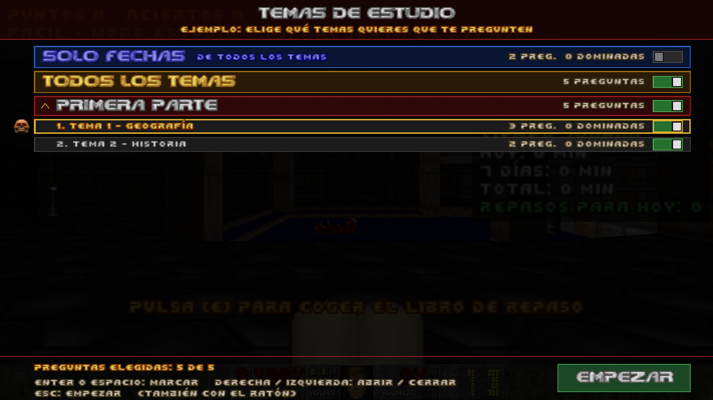
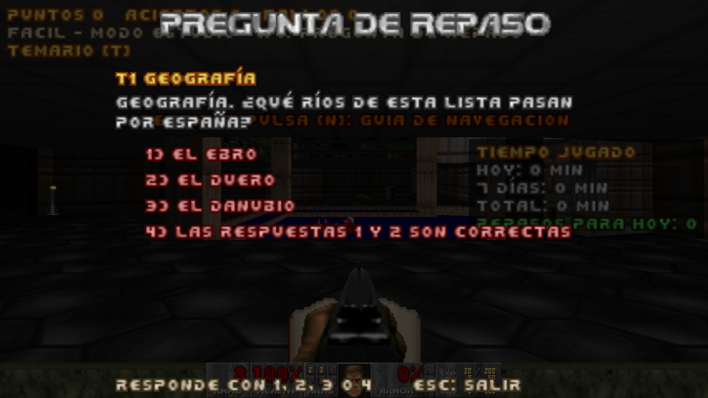
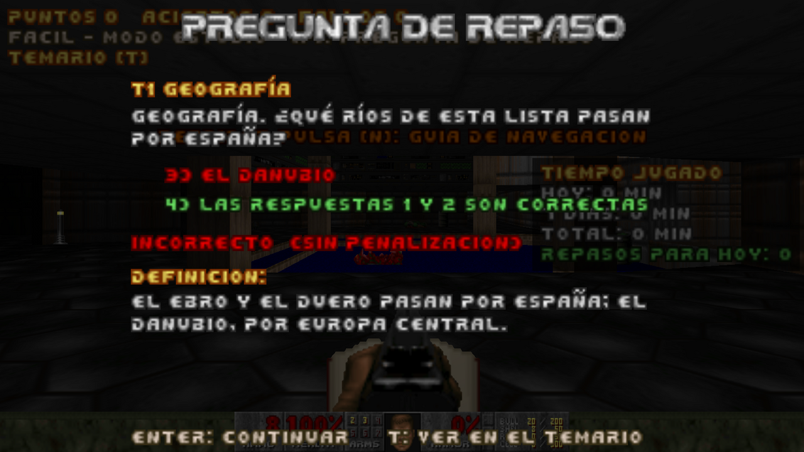

# DOOM Estudio

Mod para **GZDoom** que convierte DOOM en una forma de estudiar: para abrir puertas, coger munición, salud o llaves, y para recargar, hay que acertar preguntas tipo test.

Las preguntas **no van dentro del mod**. Cada uno pone su propio **temario** (oposiciones, idiomas, carnet de conducir, historia… lo que quiera estudiar) en una carpeta con archivos de texto.



| Pregunta | Después de responder |
|---|---|
|  |  |

## Qué hace

- **Preguntas al jugar**: puertas, interruptores, munición, armas, salud y llaves se usan con **E** y una pregunta. Las llaves piden acertar 3 preguntas difíciles seguidas.
- **Recargar con pregunta** (**R**): si aciertas, munición y el siguiente disparo mata de un golpe.
- **Tres dificultades**:
  - **Fácil (modo estudio)**: fallar no quita vida, eliges los temas en un menú, hay pistas que se retiran según aprendes y un libro de repaso con las falladas.
  - **Normal**: fallar quita vida.
  - **Ultrapesadilla**: tiempo límite y vidas de pregunta.
- **Repaso por días**: cada pregunta acertada vuelve a los 1, 3, 7, 14 y 30 días; las que tocan hoy salen antes. El progreso se guarda en tu ordenador, pregunta a pregunta.
- **Menú de temas** con grupos, temas y bloques que se encienden y se apagan, y la opción **SOLO FECHAS** para practicar solo las fechas de todos los temas.
- **Tomo del temario** (**T**): el texto del temario dentro del juego; después de responder, te lleva a la parte donde está la respuesta.
- **Guía de navegación** (**N**): te marca paso a paso la llave que falta, su puerta y la salida.
- Funciona con **DOOM normal** y con **Brutal Doom**, en solitario o en **cooperativo online** (cada jugador responde sus propias preguntas).

## Qué necesitas

- **Windows** para los `.bat` (en otros sistemas se puede lanzar GZDoom a mano, mira más abajo).
- **GZDoom 4.14 o superior**: <https://zdoom.org/downloads>
- **Tu `DOOM.WAD`** de *The Ultimate Doom* (el de Steam o GOG vale). No se incluye: es de id Software.
- Opcional: **`DOOM2.WAD`**, para tener la súper escopeta en DOOM normal. Sin él se empieza con la escopeta.
- Opcional: **Brutal Doom** (no se incluye): <https://www.moddb.com/mods/brutal-doom>

## Instalación

1. Descarga el proyecto: botón verde **Code → Download ZIP**, y descomprímelo.
2. Copia **GZDoom** (`gzdoom.exe` y el resto de archivos de su `.zip`) en la carpeta `GZDOOM`.
3. Copia tu **`DOOM.WAD`** en la carpeta `WAD` (y tu `DOOM2.WAD`, si lo tienes).
4. Opcional, súper escopeta: con Python instalado, abre una consola en la carpeta del juego y ejecuta
   `python herramientas\crear_superescopeta.py` (crea `Mod\SuperEscopeta_DOOM2.pk3` a partir de tu `DOOM2.WAD`).
5. Opcional, Brutal Doom: pon su `.pk3` en la carpeta `BrutalDOOM`.
6. Haz doble clic en **`Jugar.bat`** (o en `Jugar_Brutal.bat`). Si hay varios temarios, te pregunta cuál quieres.

Sin los `.bat` (cualquier sistema):

```
gzdoom -iwad DOOM.WAD -file Mod/DoomEstudio.pk3 Temarios/Ejemplo
```

## Crear tu propio temario

Un temario es una carpeta dentro de `Temarios` con una subcarpeta `estudio`:

```
Temarios/
  MiTemario/
    estudio/
      preguntas.txt   las preguntas (obligatorio)
      temas.txt       los grupos y temas del menú (opcional)
      temario.txt     el texto del tomo, tecla T (opcional)
```

Lo más fácil: copia la carpeta `Temarios/Ejemplo`, cámbiale el nombre y edita sus archivos con el Bloc de notas o VS Code, guardando en **UTF-8**.

**preguntas.txt**: una pregunta por línea; la respuesta correcta va siempre en el tercer campo y el juego baraja las opciones:

```
bloque|pregunta|respuesta correcta|incorrecta 1|incorrecta 2|incorrecta 3|explicación
T1 Geografía|¿Cuál es la capital de Portugal?|Lisboa|Oporto|Coímbra|Braga|Lisboa es la capital de Portugal.
```

**temas.txt**: cómo sale en el menú. Las preguntas cuyo bloque empieza por la clave (`T1`) van a ese tema:

```
NOMBRE = Mi temario
[PRIMERA PARTE]
T1 = 1. Tema 1 - Geografía
T2 = 2. Tema 2 - Historia
```

Todos los detalles (orden fijo de opciones, preguntas de fechas, formato del tomo…) están en [`Temarios/COMO_CREAR_UN_TEMARIO.txt`](Temarios/COMO_CREAR_UN_TEMARIO.txt).

Para pasarle un temario a otra persona: comprime su carpeta `estudio` en un `.zip`, cámbiale la extensión a `.pk3` y que lo ponga en su carpeta `Temarios`.

## Teclas principales

| Tecla | Qué hace |
|---|---|
| **E** | Usar / recoger (con pregunta) |
| **R** | Recargar con pregunta (en Brutal Doom, **Y**) |
| **1 a 4** | Responder |
| **L** | Libro de repaso (dentro, **M**: elegir temas) |
| **T** | Tomo del temario |
| **N** | Guía de navegación |
| **P** | Pregunta de repaso (modo fácil) |

Todas las teclas y menús: [`Instrucciones/CONTROLES.txt`](Instrucciones/CONTROLES.txt). Para jugar online: [`Instrucciones/COMO_JUGAR_ONLINE.txt`](Instrucciones/COMO_JUGAR_ONLINE.txt).

## Estructura del proyecto

```
Jugar.bat, Jugar_Brutal.bat          jugar (eligen temario y mapa al azar)
Crear_Partida_Online.bat             cooperativo online: anfitrión
Unirse_Partida_Online.bat            cooperativo online: el resto
Mod/DoomEstudio.pk3                  el mod ya compilado (el motor, sin preguntas)
Temarios/                            los temarios; Ejemplo es uno de muestra
Controles/                           las teclas que cargan los .bat
Instrucciones/                       controles y juego online
herramientas/crear_superescopeta.py  saca la súper escopeta de tu DOOM2.WAD
src/                                 código fuente del mod (ZScript)
GZDOOM/, WAD/, BrutalDOOM/           aquí pones GZDoom, tus WAD y Brutal Doom
```

## Modificar el mod

El código está en `src/`, en **ZScript** (el lenguaje de GZDoom): `zscript.zsc` (todo el juego) y `guia.zsc` (la guía de navegación). Para volver a crear el mod, comprime en `.zip` el **contenido** de `src/` (no la carpeta), cámbiale la extensión a `.pk3` y ponlo en `Mod/DoomEstudio.pk3`.

## Créditos y licencia

- Código del mod: licencia MIT (mira [`LICENSE`](LICENSE)).
- [GZDoom](https://zdoom.org).
- DOOM y DOOM II son de id Software; sus archivos no se incluyen.
- Brutal Doom es de Sergeant_Mark_IV; no se incluye.
